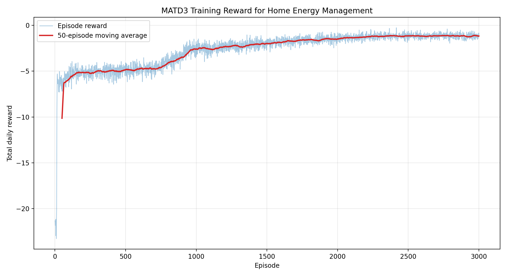
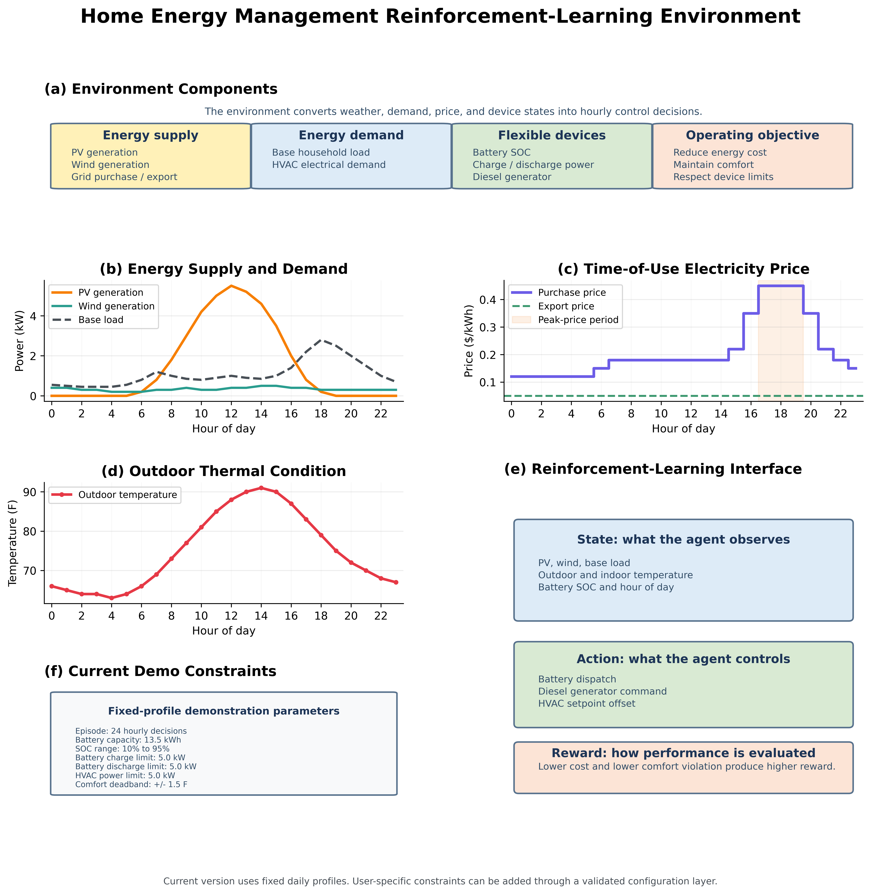
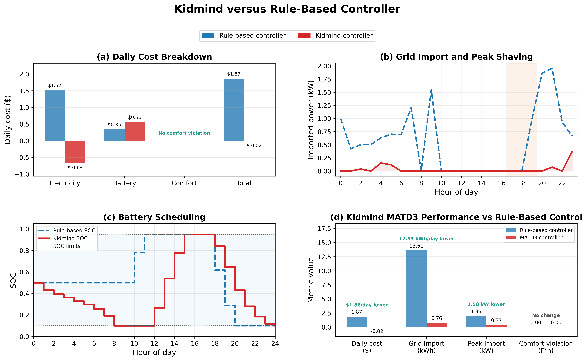

# Kidmind Household Energy Management Module
Global Runner-Up, iFLYTEK AI Developer Competition (AI Agent Innovation Application 2026)
https://github.com/Hector-sau/Livingmind.git 
## 1. Project Overview

This project is a reinforcement learning demo for a Home Energy Management System (HEMS).

The project simulates household energy operation and control over a 24-hour period. The system includes:

- Photovoltaic (PV) generation;
- Wind generation;
- Base household load;
- HVAC air-conditioning system;
- Battery Energy Storage System (BESS);
- Grid import and export- Diesel backup generator.

The reinforcement learning agent uses the MATD3 algorithm to determine the following actions every hour based on weather conditions, energy supply and demand, electricity prices, indoor temperature, and battery status:

1. Battery charging or discharging;
2. Diesel generator output power;
3. HVAC temperature setpoint offset.

The current version is mainly used to validate the following concepts:

1. Use a reinforcement learning agent to manage various household devices, such as residential HVAC systems, energy storage batteries, and diesel generators. Additional household appliance types can be added in the future.
2. Make hourly control decisions based on PV generation, wind generation, household load, outdoor temperature, electricity prices, and battery SOC.
3. Reduce the overall household operating cost while satisfying battery safety limits, device power limits, and indoor comfort requirements.
4. The daily generation, load, electricity price, device constraints, and temperature curves used in the current demo are predefined values intended mainly for algorithm validation and product demonstration. They also prepare the system for future integration with the Kidmind large language model, enabling the system to understand users' natural-language requirements and convert them into safe and verifiable device constraints and optimization objectives. These constraints and objectives can dynamically affect the power limits and temperature ranges of the reinforcement learning environment.

---

## 2. Project Directory Structure

The recommended project directory structure is as follows:

```text
Kidmind Household Energy Management Module/
└── Kidmind_Energy/
    ├── env.py
    ├── env_sample.py
    ├── main.py
    ├── matd3.py
    ├── networks.py
    ├── replay_buffer.py
    ├── sim_decision.py
    ├── three_phase_BFS.py
    ├── plot_environment_overview.py
    ├── plot_product_demo.py
    ├── readme.md
    ├── IEEE_123_3ph.mat
    ├── model/
    │   └── HomeEnergy/
    │       └── ...MATD3 model files saved after training...
    └── demo_figures/
        └── ...images generated by the plotting scripts...
```

Description of the main files:

| File | Description |
|---|---|
| `env.py` | The household energy management reinforcement learning environment, including battery, HVAC, grid, PV, wind, household load, and diesel generator models. |
| `main.py` | The main MATD3 reinforcement learning training program. The Actor model is saved after training. |
| `matd3.py` | Implementation of the MATD3 algorithm. |
| `networks.py` | Definitions of the Actor and Critic neural networks. |
| `replay_buffer.py` | Experience replay buffer for reinforcement learning. |
| `plot_environment_overview.py` | Generates an overview figure of the household energy management environment. |
| `plot_product_demo.py` | Loads the trained MATD3 model and generates the single-day product demo figure and the Rule-based comparison figure. |
| `model/` | Stores the trained models. |
| `demo_figures/` | Stores images generated by the plotting scripts. |

---

## 3. Environment Setup

Python 3.9 or a later version is recommended.

Install the basic dependencies:

```bash
pip install numpy matplotlib torch gym
```

Using a virtual environment is recommended.

### Windows

```bash
python -m venv venv
venv\Scripts\activate
pip install numpy matplotlib torch gym
```

### macOS / Linux

```bash
python3 -m venv venv
source venv/bin/activate
pip install numpy matplotlib torch gym
```

---

## 4. Execution Order

Run the following commands from the `Kidmind_Energy/` directory.

### Step 1: Train the MATD3 Controller

```bash
python main.py
```

The main responsibilities of `main.py` are:

1. Create the household energy management environment `GYMEnv`;
2. Initialize the MATD3 reinforcement learning agent;
3. Train the agent over multiple 24-hour episodes;
4. Update the Actor and Critic networks according to the environment rewards;
5. Save the trained MATD3 Actor model.

After training, the model is normally saved in:

```text
model/HomeEnergy/
```

`plot_product_demo.py` depends on the Actor model saved in this directory.

### Step 2: Generate the Environment Overview Figure

```bash
python plot_environment_overview.py
```

Output file:

```text
demo_figures/home_energy_environment_overview.png
```

This step does not depend on a trained model and can be executed directly.

### Step 3: Generate the Product Demo and Strategy Comparison Figures

```bash
python plot_product_demo.py
```

Output files:

```text
demo_figures/home_energy_product_demo.png
demo_figures/rule_vs_agent_summary.png
```

This step must be executed after `main.py` has completed training and the model has been saved.

If a "trained model not found" message appears, check the following:

1. Whether `python main.py` has been executed;
2. Whether an Actor model exists in the `model/HomeEnergy/` directory;
3. Whether the `max_episodes` value in `plot_product_demo.py` is consistent with the setting used during training;
4. Whether the model save path and naming convention are consistent with `MATD3.save_model()`.

---

# 5. Household Energy Management Environment

## 5.1 What Does One Episode Represent?

In the current environment:

```text
One episode = one day
One day = 24 time steps
One time step = one hour
```

The reinforcement learning agent receives the environment state and provides one control action every hour.

For example, at 17:00, the agent may observe that:

- The grid electricity price is high;
- PV generation has declined;
- The household base load is increasing;
- The outdoor temperature is still high;
- The battery still has available energy.

The agent may then choose to:

- Discharge the battery;
- Reduce electricity purchased from the grid;
- Slightly increase the HVAC temperature setpoint;
- Maintain indoor comfort while reducing operating costs as much as possible.

---

## 5.2 Energy Supply in the Environment

The household can use the following energy sources:

| Energy Source | Description |
|---|---|
| PV generation | Produces electricity during the daytime and typically reaches a high level around noon. |
| Wind generation | Acts as a small household wind power source with relatively stable output. |
| Battery storage | Can be charged when PV generation is sufficient or electricity prices are low, and discharged during high-price periods. |
| Grid | Electricity is purchased from the grid when household generation and battery energy cannot meet the load. Excess energy can be sold back to the grid. |
| Diesel generator | Serves as a backup power source. It can be controlled in the current demo but is generally not used as the first choice. |

---

## 5.3 Household Load

The total household electricity load consists of two parts:

```text
Total load = Base household load + HVAC load
```

Where:

- The base household load includes lighting, household appliances, electronic devices, and other basic loads;
- The HVAC load is determined jointly by outdoor temperature, indoor temperature, the temperature setpoint, and the HVAC control action.

---

## 5.4 Time-of-Use Electricity Pricing

The environment uses a predefined time-of-use electricity price curve:

- Electricity prices are lower at night and during the early morning;
- Prices are moderate during the daytime;
- The evening is the peak-price period;
- The main peak-price period in the current environment is approximately `17:00–19:59`.

The reinforcement learning agent attempts to learn strategies such as:

```text
During low-price periods or when renewable generation is sufficient:
    Charge the battery or reduce electricity costs.

During high-price periods:
    Discharge the battery to reduce grid purchases.

When excess energy is available:
    Export electricity to the grid.

During peak periods:
    Reduce the maximum grid import power to achieve peak shaving.
```

---

# 6. Reinforcement Learning Interface

## 6.1 State Space

The environment provides the agent with a 7-dimensional normalized state:

```text
[PV, wind, base_load, outdoor_temp, indoor_temp, SOC, hour]
```

The meanings of the state variables are as follows:

| State | Description |
|---|---|
| `PV` | PV generation power at the current time step. |
| `wind` | Wind generation power at the current time step. |
| `base_load` | Current base household load, excluding HVAC load. |
| `outdoor_temp` | Current outdoor temperature. |
| `indoor_temp` | Current indoor temperature. |
| `SOC` | Battery State of Charge. |
| `hour` | Current hour of the day. |

The normalized state is passed to the MATD3 Actor network to improve the stability of reinforcement learning training.

---

## 6.2 Action Space

The environment uses a 3-dimensional continuous action:

```text
[battery_action, diesel_action, hvac_action]
```

The raw range of each action dimension is:

```text
[-1, 1]
```

The action meanings are as follows:

| Action | Description | Actual Mapping |
|---|---|---|
| `battery_action` | Battery charging and discharging control | A positive value indicates charging, while a negative value indicates discharging. |
| `diesel_action` | Diesel generator power control | Mapped to `0 kW` through the maximum diesel generator power. |
| `hvac_action` | HVAC temperature setpoint offset | Mapped to `-2°F` through `+2°F`. |

### Battery Action Description

```text
battery_action > 0: Battery charging
battery_action < 0: Battery discharging
battery_action = 0: Neither charging nor discharging
```

The actual battery action is also subject to the following constraints:

```text
- Maximum charging power;
- Maximum discharging power;
- Battery capacity;
- Minimum SOC;
- Maximum SOC;
- Charging and discharging efficiency.
```

### Grid Power Description

```text
grid_kw > 0: Electricity purchased from the grid
grid_kw < 0: Electricity exported to the grid
```

---

# 7. HVAC and Thermal Comfort Model

The HVAC system in the environment uses a simplified household thermal model. HVAC power consumption and indoor temperature changes are calculated based on:

- Current indoor temperature;
- Current outdoor temperature;
- Current HVAC temperature setpoint;
- Building thermal resistance;
- Building thermal capacitance;
- HVAC cooling and heating efficiency;
- Maximum HVAC electrical power.

The default HVAC temperature setpoint schedule is:

| Time | Default Temperature Setpoint |
|---|---|
| 00:00–06:59 | 76°F |
| 07:00–18:59 | 74°F |
| 19:00–23:59 | 76°F |

The reinforcement learning agent cannot directly specify HVAC electrical power. Instead, it adjusts the temperature setpoint offset to influence HVAC operation.

For example:

```text
hvac_action = -1.0  → Decrease the temperature setpoint by 2°F
hvac_action =  0.0  → Use the default scheduled temperature setpoint
hvac_action =  1.0  → Increase the temperature setpoint by 2°F
```

The environment also defines a comfort deadband:

```text
Default comfort deadband: ±1.5°F
```

If the indoor temperature exceeds the comfort range around the effective temperature setpoint, the environment calculates the degree of comfort violation and adds a penalty to the reward.

---

# 8. Reward Design

The reward function is designed to jointly consider economic performance, device usage, and user comfort.

The basic form is:

```text
reward = -(
    electricity_cost
    + diesel_cost
    + battery_cost
    + comfort_cost
)
```

In other words:

```text
The lower the total cost, the higher the reward.
```

The main reward components include:

| Cost Component | Description |
|---|---|
| `electricity_cost` | The cost of purchasing electricity from the grid or the revenue obtained from selling electricity to the grid. |
| `diesel_cost` | The fuel cost of operating the diesel generator. |
| `battery_cost` | The usage or degradation cost associated with charging and discharging the battery. |
| `comfort_cost` | The penalty incurred when the indoor temperature exceeds the comfort range. |

Therefore, the agent must balance the following objectives:

```text
Reduce electricity costs;
Reduce peak grid imports;
Minimize diesel generator usage;
Avoid excessive battery usage;
Maintain indoor comfort;
Respect all device operating limits.
```

---

# 9. Plotting Scripts

## 9.1 MATD3 Training Convergence Figure: `training_reward.png`

Run the training program:

```bash
python main.py
```

The MATD3 agent interacts with the household energy management environment over multiple training episodes. Each episode represents a complete 24-hour household energy scheduling cycle.

During training, the agent continuously learns how to optimize the following control decisions based on PV generation, wind generation, household load, time-of-use electricity prices, indoor and outdoor temperatures, and battery SOC:

```text
- Battery charging and discharging;
- Diesel backup generator power;
- HVAC temperature setpoint offset;
- Timing of grid electricity purchases and exports.
```

After training is completed, `main.py` generates and saves the training reward curve:

```text
demo_figures/training_reward.png
```



This figure shows the training process and convergence trend of the MATD3 reinforcement learning controller in the household energy management environment.

The figure contains two curves:

| Curve | Description |
|---|---|
| Episode reward | The total reward obtained in each training episode. This curve may show significant short-term fluctuations. |
| 50-episode moving average | The moving average of the rewards from the most recent 50 episodes, used to observe the overall training trend and whether the policy is gradually converging. |

Axis descriptions:

```text
Horizontal axis — Episode:
    The number of training episodes.
    Each episode corresponds to one day, or 24 hours of household energy management decisions.

Vertical axis — Total daily reward:
    The cumulative reward obtained by the agent over that day.
```

In the current environment, the reward is related to the total daily operating cost:

```text
reward = -(
    electricity_cost
    + diesel_cost
    + battery_cost
    + comfort_cost
)
```

Therefore:

```text
A higher reward:
    Indicates a lower overall daily operating cost,
    or a better balance between electricity costs, battery usage,
    device constraints, and indoor comfort.

A negative reward:
    Does not indicate training failure.
    The environment defines electricity costs, battery costs,
    and comfort penalties as positive costs,
    while the reward is represented by the negative value of these costs.
```

The training curve can be interpreted as follows:

```text
1. During the early stage of training, the reward is relatively low and highly variable.
   At this stage, the agent is still exploring and trying different battery,
   HVAC, and diesel generator control actions.

2. As the number of episodes increases, the 50-episode moving average continues to rise.
   This indicates that MATD3 is gradually learning better energy scheduling policies,
   such as charging when PV generation is sufficient, discharging during high-price periods,
   and adjusting HVAC loads while maintaining acceptable comfort.

3. During the later stage of training, the moving average reward gradually becomes stable.
   This indicates that the policy has basically converged,
   and continued training will result in progressively smaller performance improvements.

4. It is normal for individual episode rewards to continue fluctuating during the later stage of training.
   Continuous actions, exploration noise, and network parameter updates can all cause short-term variations.
   When determining whether the model has converged, focus on the red moving-average curve
   rather than only the blue episode reward curve.
```

The trained MATD3 Actor model is loaded by `plot_product_demo.py` to generate the subsequent single-day energy scheduling and Rule-based comparison figures:

```text
demo_figures/home_energy_product_demo.png
demo_figures/rule_vs_agent_summary.png
```

---

## 9.2 Environment Overview Figure: `plot_environment_overview.py`

Run the following command:

```bash
python plot_environment_overview.py
```

Output image:

```text
demo_figures/home_energy_environment_overview.png
```



This figure illustrates the basic components, input states, action space, reward mechanism, and current fixed constraints of the household energy management environment.

The figure contains the following six sections:

| Subfigure | Name | Content |
|---|---|---|
| (a) | Environment Components | Shows energy supply, energy demand, controllable devices, and operating objectives. |
| (b) | Energy Supply and Demand | Shows the 24-hour curves of PV generation, wind generation, and base household load. |
| (c) | Time-of-Use Electricity Price | Shows the electricity purchase price, electricity export price, and peak-price period. |
| (d) | Outdoor Thermal Condition | Shows outdoor temperature changes. Outdoor temperature affects HVAC operating requirements. |
| (e) | Reinforcement Learning Interface | Shows the state observed by the agent, the actions controlled by the agent, and the meaning of the reward. |
| (f) | Current Demo Constraints | Shows the fixed battery capacity, SOC range, maximum charging and discharging power, maximum HVAC power, and comfort deadband used in the current demo. |

This figure is suitable for explaining:

```text
What objects are managed by the current reinforcement learning module;
What information the reinforcement learning model observes;
What the reinforcement learning model can control;
What device safety limits are used in the current demo;
How future large language model instructions may modify these constraints.
```

---

## 9.3 Product Demo Figure: `plot_product_demo.py`

Run the following command:

```bash
python plot_product_demo.py
```

Prerequisites:

```text
1. The training process in main.py has been completed;
2. The MATD3 Actor model has been saved;
3. The model file is located in model/HomeEnergy/;
4. The max_episodes setting is consistent between training and plotting.
```

The script runs the following two controllers:

```text
1. Kidmind controller:
   The trained MATD3 reinforcement learning controller.

2. Rule-based controller:
   A rule-based controller used for comparison.
```

The basic logic of the Rule-based strategy includes:

```text
- Charge the battery when PV generation is high;
- Discharge the battery when electricity prices are high;
- Do not use the diesel generator by default;
- Increase the HVAC temperature setpoint during the evening peak period
  to reduce cooling load.
```

---

### 9.3.1 Single-Day Energy Management Strategy Figure

Output image:

```text
demo_figures/home_energy_product_demo.png
```


This figure shows the energy scheduling strategy of the Kidmind MATD3 controller over a complete 24-hour episode.

The figure is divided into three sections.

#### (a) Battery Energy Storage System Operation

This section shows the operating status of the battery energy storage system:

```text
- Charging power (+): Battery charging power;
- Discharging power (-): Battery discharging power;
- Battery SOC: Battery State of Charge;
- SOC limits: Battery SOC safety boundaries.
```

Interpretation:

```text
Positive battery power: Charging;
Negative battery power: Discharging;
SOC must remain between the minimum and maximum values specified by the environment.
```

This figure is mainly used to evaluate whether the agent can:

```text
- Charge when PV generation is sufficient or electricity prices are low;
- Discharge during peak-price periods;
- Avoid battery overcharging or over-discharging;
- Use the battery to reduce high-price electricity purchases and maximum grid import power.
```

#### (b) HVAC Thermal Comfort Management

This section shows HVAC control and indoor thermal comfort:

```text
- HVAC electrical power: HVAC electricity consumption;
- Outdoor temperature: Outdoor temperature;
- Indoor temperature: Indoor temperature;
- Agent setpoint: Temperature setpoint actually used by the agent;
- Comfort band: Comfortable temperature range.
```

This figure is used to determine whether the agent can:

```text
- Maintain indoor comfort when outdoor temperatures increase;
- Reduce HVAC energy consumption by adjusting the temperature setpoint;
- Avoid excessive comfort violations while reducing operating costs;
- Moderately reduce HVAC load during peak electricity-price periods.
```

#### (c) Energy Trading with the Grid

This section shows energy transactions between the household and the grid:

```text
- Grid import (purchase): Electricity purchased from the grid;
- Grid export (sell): Electricity sold to the grid;
- Retail electricity price: The real-time electricity purchase price.
```

Interpretation:

```text
Positive grid power: Electricity purchased from the grid;
Negative grid power: Electricity exported to the grid;
Light orange shading: Peak electricity-price period.
```

This figure can be used to evaluate:

```text
- Whether grid purchases are reduced during high-price periods;
- Whether sufficient PV generation reduces grid purchases or creates exports;
- Whether the battery helps achieve peak shaving;
- Whether the agent adjusts its energy usage strategy according to dynamic electricity prices.
```

The top of the figure displays the following key daily KPIs:

```text
Net daily cost:
    The total operating cost for the day.

Grid import:
    The total amount of electricity purchased from the grid during the day.

Grid export:
    The total amount of electricity sold to the grid during the day.

HVAC energy:
    The total daily electricity consumption of the HVAC system.

Peak import:
    The maximum grid import power.

Comfort violation:
    The cumulative degree of indoor temperature deviation from the comfort range.
```

---

### 9.3.2 Rule-based versus MATD3 Comparison Figure

Output image:

```text
demo_figures/rule_vs_agent_summary.png
```



This figure compares the operating performance of traditional Rule-based control and Kidmind MATD3 reinforcement learning control.

The figure contains four sections.

#### (a) Daily Cost Breakdown

This section shows the daily cost components of the two control strategies:

```text
- Electricity: Electricity purchase and export cost;
- Battery: Battery usage cost;
- Comfort: Comfort violation cost;
- Total: Total operating cost.
```

This figure is used to determine whether MATD3 can reduce total operating costs while maintaining indoor comfort.

#### (b) Grid Import and Peak Shaving

This section shows the grid import power curves of the two strategies.

The main points of interest are:

```text
- Whether Kidmind MATD3 reduces grid purchases during peak periods;
- Whether Kidmind MATD3 reduces the maximum grid import power;
- Whether the battery contributes to peak shaving during peak periods.
```

#### (c) Battery Scheduling

This section shows the battery SOC curves under the two strategies.

The main points of interest are:

```text
- Whether the battery SOC always remains within the safety range;
- Whether the charging and discharging times differ between the two strategies;
- Whether MATD3 can make more flexible SOC scheduling decisions based on real-time conditions.
```

#### (d) Kidmind MATD3 Performance vs Rule-Based Control

This section compares the key KPIs of the two strategies:

```text
- Daily cost: Total daily cost;
- Grid import: Total daily electricity purchased from the grid;
- Peak import: Maximum grid import power;
- Comfort violation: Degree of comfort violation.
```

The figure labels the improvements or reductions achieved by MATD3 compared with the Rule-based strategy, for example:

```text
$0.XX/day lower
XX.XX kWh/day lower
XX.XX kW lower
XX.XX F*h lower
```

“Lower” generally means that the value of the metric is lower. However, the comfort metric must also be considered when evaluating the strategy. Electricity cost or grid import should not be considered in isolation.

---

# 10. Console Output

After running `plot_product_demo.py`, the console displays daily operating reports for both the MATD3 and Rule-based strategies.

The main outputs include:

```text
Total reward
Daily operating cost
Electricity cost
Battery degradation cost
Comfort penalty
Grid import
Grid export
Peak grid import
HVAC electricity use
Battery charge/discharge
Comfort violation
Indoor temperature range
```

The script then reports the changes achieved by MATD3 compared with the Rule-based strategy:

```text
Operating cost difference
Grid import difference
Peak import difference
Comfort violation difference
```

These metrics can be used for product demonstrations, model evaluation, and future experimental comparisons.

---

# 11. Default Constraints in the Current Demo

The current environment uses a fixed configuration that mainly includes the following parameters:

| Parameter | Current Demo Setting |
|---|---|
| Episode length | 24 hours |
| Time resolution | 1 hour |
| Battery capacity | 13.5 kWh |
| Initial SOC | 50% |
| Minimum SOC | 10% |
| Maximum SOC | 95% |
| Maximum battery charging power | 5.0 kW |
| Maximum battery discharging power | 5.0 kW |
| Maximum diesel generator power | 6.0 kW |
| Maximum HVAC electrical power | 5.0 kW |
| HVAC temperature offset range | -2°F to +2°F |
| Comfort deadband | ±1.5°F |

These parameters are currently defined in the environment code and serve as predefined demo parameters.

---

# 12. Relationship with the Kidmind Large Language Model Architecture

The current demo focuses on validating the following concept:

```text
Under fixed environmental constraints, can MATD3 learn an effective household energy scheduling strategy?
```

After future integration with the Kidmind large language model, the system will be extended as follows:

```text
User natural-language instruction
        ↓
The Kidmind large language model understands the user's intent
        ↓
The large language model outputs structured constraints and optimization objectives
        ↓
The constraint validation layer checks units, conflicts, and device safety limits
        ↓
The reinforcement learning environment parameters are updated dynamically
        ↓
MATD3 schedules the battery, HVAC system, diesel generator, and grid
        under the new constraints
        ↓
The product interface displays control results, costs, comfort metrics,
        and explanations
```

---

## 12.1 Examples of User Instructions

Users can express preferences and device constraints in natural language, for example:

```text
“I want to reduce my household electricity bill, but the indoor temperature should not fall below 72°F at night.”

“Do not allow the HVAC power to exceed 2.1 kW.”

“Keep the battery energy between 3 kWh and 8 kWh.”

“Set the maximum battery charging and discharging power to 2.5 kW.”

“Use PV and wind generation as much as possible.”

“Try not to purchase electricity from the grid during peak-price periods.”

“I care more about comfort and allow the electricity bill to increase slightly.”

“Someone will arrive home at 7:00 p.m. Please bring the indoor temperature into the comfortable range in advance.”
```

---

## 12.2 Example of Structured Constraints Generated by the Large Language Model

In the future, the large language model can convert natural-language instructions into structured configuration similar to the following:

```json
{
  "objective": {
    "minimize_energy_cost": true,
    "minimize_peak_grid_import": true,
    "prioritize_comfort": true,
    "prioritize_renewable_energy": false
  },
  "constraints": {
    "indoor_temp_min_f": 72.0,
    "indoor_temp_max_f": 76.0,
    "max_hvac_kw": 2.1,
    "battery_soc_min_kwh": 3.0,
    "battery_soc_max_kwh": 8.0,
    "battery_max_charge_kw": 2.5,
    "battery_max_discharge_kw": 2.5
  }
}
```

The configuration layer can then map these constraints to environment parameters, such as:

```text
env.hvac.max_hvac_kw
env.hvac.comfort_deadband_f
env.hvac.setpoint_delta_min
env.hvac.setpoint_delta_max

env.battery_max_charge_kw
env.battery_max_discharge_kw
env.soc_min
env.soc_max

Electricity cost, comfort, renewable energy, and peak-load weights in the reward function
```

---

## 12.3 Safety and Validation Principles

The large language model should not bypass device limits to control real devices directly.

The recommended system architecture is as follows:

```text
Large language model:
    Responsible for understanding the user's natural-language requirements.

Structured constraint layer:
    Responsible for converting user requirements into standardized parameters.

Validation layer:
    Responsible for unit conversion, range checking, logical conflict checking,
    and verification against device ratings.

Reinforcement learning controller:
    Responsible for finding an optimal control strategy within legal and safe constraints.

Device execution layer:
    Responsible for sending validated control commands to real or simulated devices.
```

For example, when a user enters:

```text
“Set the HVAC power limit to 20 kW.”
```

but the actual device has a maximum power of only `5 kW`, the validation layer should:

```text
- Reject a setting that exceeds the rated capability of the device;
- Restrict the request to the safe operating range;
- Inform the user of the actual maximum available power;
- Record the final effective configuration.
```

---

# 13. Current Limitations

The current version is mainly intended for algorithm validation and product concept demonstration. It has the following limitations:

1. PV generation, wind generation, base household load, outdoor temperature, and electricity prices are all predefined 24-hour curves;
2. Real smart meter data, weather forecasts, and actual device data have not yet been integrated;
3. The natural-language understanding module based on the large language model has not yet been integrated;
4. Device constraints are still fixed in the code;
5. The HVAC system uses a simplified thermal model and does not represent the actual thermal characteristics of every building;
6. Only a single household is currently simulated;
7. Each episode currently simulates only one day;
8. The current diesel generator model is a simplified backup energy model;
9. The current results are mainly intended for demonstrations and should not be used directly to control real devices;
10. Before real-world deployment, the system still needs permission management, fault handling, anomaly detection, manual override, and device communication mechanisms.

---

# 14. Future Development

The following directions can be considered for future expansion:

```text
1. Integrate the Kidmind large language model for natural-language instruction parsing;
2. Define a unified JSON Schema for energy-related constraints;
3. Add parameter validation, unit conversion, and conflict detection modules;
4. Support dynamic modification of HVAC, battery, and diesel generator power limits;
5. Support dynamic modification of indoor temperature ranges and comfort weights;
6. Support user preferences such as energy-saving priority, comfort priority,
   low-carbon priority, and peak-shaving priority;
7. Integrate real-time weather data, PV forecasts, electricity price forecasts,
   and load forecasts;
8. Support multiple days, multiple seasons, and different household configurations;
9. Add systematic comparisons among Rule-based methods, optimization methods,
   and reinforcement learning methods;
10. Display user instructions, parsed results, effective constraints,
    control decisions, and result explanations in the Kidmind product.
```

---

# 15. One-Sentence Demo Description

> This is a household energy management simulation module that models the operation of PV generation, wind generation, household load, HVAC, battery storage, the grid, and a diesel generator over a single day. Every hour, the MATD3 reinforcement learning controller determines how to charge or discharge the battery, adjust the HVAC system, and use backup generation based on energy supply and demand, electricity prices, temperature, and battery status. In the future, the Kidmind large language model will convert users' natural-language requirements into safe and verifiable device constraints, after which the reinforcement learning controller will automatically manage household energy within those constraints.
