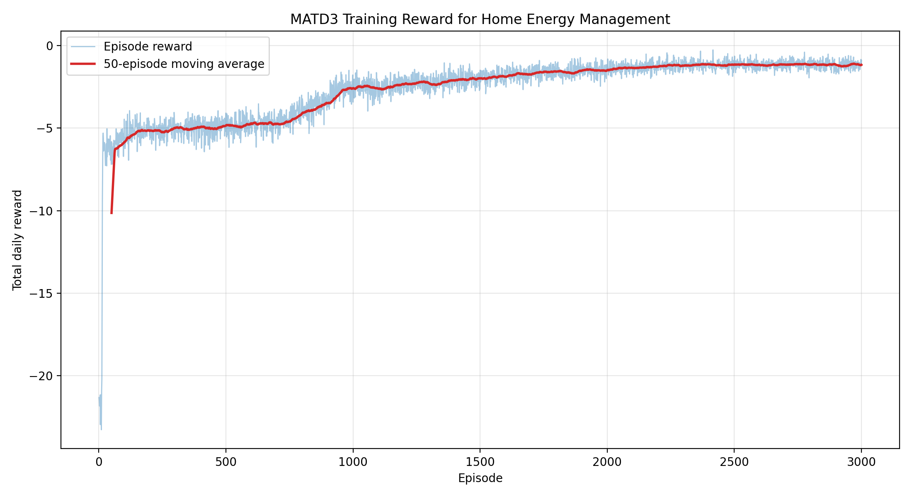
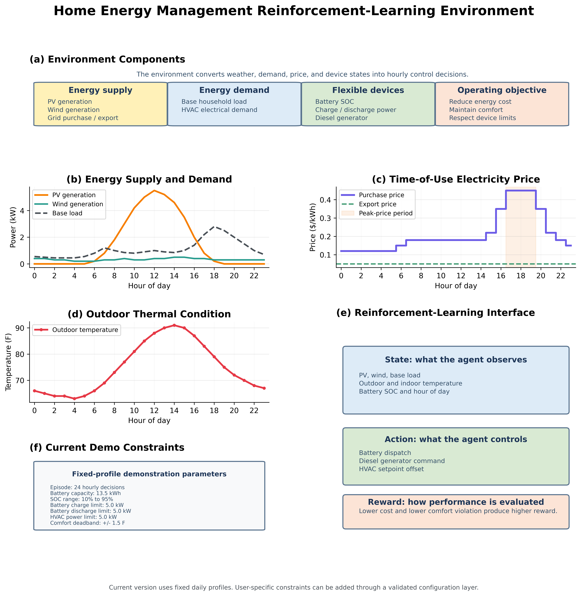
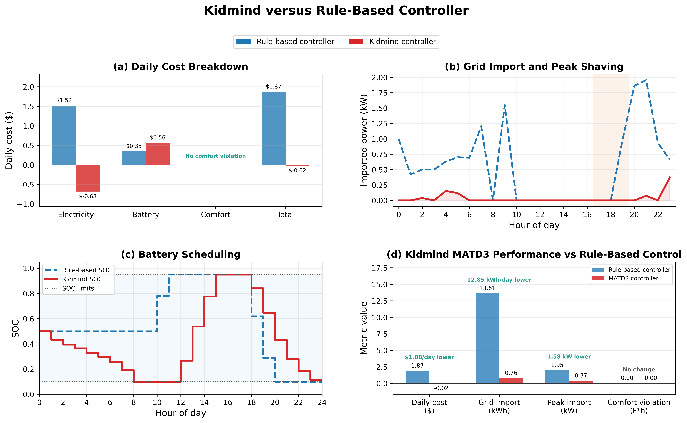

---
# Kidmind Household Energy Management Module

## 1. 项目简介

本项目是一个面向家庭能源管理（Home Energy Management System, HEMS）的强化学习 Demo。

项目模拟家庭在 24 小时内的能源运行与控制过程，系统包含：

- 光伏发电（PV generation）；
- 风力发电（Wind generation）；
- 家庭基础用电负荷（Base household load）；
- HVAC 空调系统；
- 家庭电池储能系统（Battery Energy Storage System, BESS）；
- 电网购电与售电（Grid import / export）；
- 柴油备用发电机（Diesel generator）。

强化学习智能体使用 MATD3 算法，根据每小时的天气、能源供需、电价、室内温度和电池状态，决定：

1. 电池充电或放电；
2. 柴油发电机输出功率；
3. HVAC 空调设定温度偏移量。

当前版本主要用于验证以下思路：

1. 使用强化学习智能体管理家庭中各类设备，例如：家用空调、储能电池以及柴油发电机等。（家用电器类型可以继续扩充）
2. 根据光伏、风力、家庭负载、室外温度、电价和电池 SOC 等信息做出每小时控制决策。
3. 系统目标是在满足电池安全边界、设备功率边界和室内舒适度要求的前提下，降低家庭综合运行成本。
4. 当前 Demo 中使用的日发电、负荷、电价、设备约束和温度曲线为预设值，主要用于算法验证和产品展示。为后续接入 Kidmind 大模型做准备，使系统理解用户的自然语言需求，并将其转换为安全、可验证的设备约束和优化目标，动态影响强化学习环境的功率上下限和温度范围。

---

## 2. 项目目录结构

建议项目目录结构如下：

```text
Kidmind Household Energy Management Module/
└── Kidmind_Energy/
    ├── env.py
    ├── env_sample.py
    ├── main.py
    ├── matd3.py
    ├── networks.py
    ├── replay_buffer.py
    ├── sim_decision.py
    ├── three_phase_BFS.py
    ├── plot_environment_overview.py
    ├── plot_product_demo.py
    ├── readme.md
    ├── IEEE_123_3ph.mat
    ├── model/
    │   └── HomeEnergy/
    │       └── ...训练完成后保存的 MATD3 模型文件...
    └── demo_figures/
        └── ...绘图程序输出的图片...
```

主要文件说明：

| 文件 | 作用 |
|---|---|
| `env.py` | 家庭能源管理强化学习环境，包括电池、HVAC、电网、光伏、风力、负荷和柴油机模型。 |
| `main.py` | MATD3 强化学习训练主程序。训练完成后保存 Actor 模型。 |
| `matd3.py` | MATD3 算法实现。 |
| `networks.py` | Actor / Critic 神经网络定义。 |
| `replay_buffer.py` | 强化学习经验回放缓存。 |
| `plot_environment_overview.py` | 生成家庭能源管理环境概览图。 |
| `plot_product_demo.py` | 加载训练后的 MATD3 模型，生成单日产品 Demo 图及 Rule-based 对比图。 |
| `model/` | 保存训练得到的模型。 |
| `demo_figures/` | 保存绘图程序生成的图片。 |

---

## 3. 环境安装

建议使用 Python 3.9 或更高版本。

安装基础依赖：

```bash
pip install numpy matplotlib torch gym
```

建议使用虚拟环境。

### Windows

```bash
python -m venv venv
venv\Scripts\activate
pip install numpy matplotlib torch gym
```

### macOS / Linux

```bash
python3 -m venv venv
source venv/bin/activate
pip install numpy matplotlib torch gym
```

---

## 4. 运行顺序

请在 `Kidmind_Energy/` 目录下执行以下命令。

### 第一步：训练 MATD3 控制器

```bash
python main.py
```

`main.py` 的主要职责是：

1. 创建家庭能源管理环境 `GYMEnv`；
2. 初始化 MATD3 强化学习智能体；
3. 在多个 24 小时 episode 中进行训练；
4. 根据环境 reward 更新 Actor 和 Critic 网络；
5. 保存训练完成的 MATD3 Actor 模型。

训练完成后，模型通常保存在：

```text
model/HomeEnergy/
```

`plot_product_demo.py` 会依赖此处保存的 Actor 模型。

### 第二步：生成环境概览图

```bash
python plot_environment_overview.py
```

输出文件：

```text
demo_figures/home_energy_environment_overview.png
```

该步骤不依赖训练完成的模型，可以直接运行。

### 第三步：生成产品 Demo 和策略对比图

```bash
python plot_product_demo.py
```

输出文件：

```text
demo_figures/home_energy_product_demo.png
demo_figures/rule_vs_agent_summary.png
```

该步骤必须在 `main.py` 完成训练且模型已保存后运行。

如果出现“找不到已训练模型”的提示，请检查：

1. 是否已经运行过 `python main.py`；
2. `model/HomeEnergy/` 目录下是否存在 Actor 模型；
3. `plot_product_demo.py` 中的 `max_episodes` 是否与训练时的设置一致；
4. 模型保存路径和模型命名规则是否与 `MATD3.save_model()` 一致。

---

# 5. 家庭能源管理环境说明

## 5.1 一个 Episode 代表什么

当前环境中：

```text
一个 episode = 一天
一天 = 24 个时间步
一个时间步 = 1 小时
```

强化学习智能体每小时接收一次环境状态，并给出一次控制动作。

例如，在下午 17:00，智能体可能观察到：

- 电网电价较高；
- 光伏发电已经下降；
- 家庭基础负载正在上升；
- 室外温度仍然较高；
- 电池中仍有可用电量。

此时，智能体可能选择：

- 让电池放电；
- 减少从电网购电；
- 适度提高空调设定温度；
- 尽量在节约成本的同时维持室内舒适度。

---

## 5.2 环境中的能源供给

家庭可使用的能源来源包括：

| 能源来源 | 说明 |
|---|---|
| 光伏发电 | 白天产生电能，通常在中午附近达到较高水平。 |
| 风力发电 | 作为小型家庭风力发电来源，功率相对平稳。 |
| 电池储能 | 可在光伏充足或低电价时充电，在高电价时段放电。 |
| 电网 | 当家庭发电和电池无法满足负荷时，从电网购电；能源富余时可向电网售电。 |
| 柴油发电机 | 作为备用电源，当前 Demo 中允许控制但通常不优先使用。 |

---

## 5.3 家庭负荷

总家庭用电负荷由两部分组成：

```text
总负荷 = 基础家庭负荷 + HVAC 空调负荷
```

其中：

- 基础家庭负荷包括照明、家电、电子设备等；
- HVAC 负荷由室外温度、室内温度、设定温度和空调控制动作共同决定。

---

## 5.4 分时电价

环境中设置了固定的分时电价曲线：

- 夜间和凌晨电价较低；
- 白天电价中等；
- 傍晚为高峰电价时段；
- 当前环境中重点标记的峰值电价时段约为 `17:00–19:59`。

强化学习智能体会尝试学习以下策略：

```text
低电价或光伏充足时：充电或减少购电成本；
高电价时：使用电池放电，降低电网购电；
能源富余时：向电网售电；
高峰时段：减少最大购电功率，实现削峰。
```

---

# 6. 强化学习接口

## 6.1 状态空间

环境向智能体提供 7 维归一化状态：

```text
[PV, wind, base_load, outdoor_temp, indoor_temp, SOC, hour]
```

具体含义如下：

| 状态 | 含义 |
|---|---|
| `PV` | 当前时刻光伏发电功率。 |
| `wind` | 当前时刻风力发电功率。 |
| `base_load` | 当前基础家庭负荷，不包含 HVAC 负荷。 |
| `outdoor_temp` | 当前室外温度。 |
| `indoor_temp` | 当前室内温度。 |
| `SOC` | 电池荷电状态（State of Charge）。 |
| `hour` | 当前小时数。 |

状态归一化后输入 MATD3 Actor 网络，以提高强化学习训练的稳定性。

---

## 6.2 动作空间

环境使用 3 维连续动作：

```text
[battery_action, diesel_action, hvac_action]
```

每一个动作维度的原始范围均为：

```text
[-1, 1]
```

动作含义如下：

| 动作 | 含义 | 实际映射 |
|---|---|---|
| `battery_action` | 电池充放电控制 | 正值表示充电，负值表示放电。 |
| `diesel_action` | 柴油机功率控制 | 映射到 `0 kW` 至最大柴油机功率。 |
| `hvac_action` | HVAC 设定温度偏移 | 映射到 `-2°F` 至 `+2°F`。 |

### 电池动作说明

```text
battery_action > 0：电池充电
battery_action < 0：电池放电
battery_action = 0：不充电也不放电
```

电池实际动作还会受到以下约束：

```text
- 最大充电功率；
- 最大放电功率；
- 电池容量；
- 最低 SOC；
- 最高 SOC；
- 充放电效率。
```

### 电网功率说明

```text
grid_kw > 0：从电网购电
grid_kw < 0：向电网售电
```

---

# 7. HVAC 空调与舒适度模型

环境中的 HVAC 使用简化的家庭热模型，根据以下因素计算空调功率和室内温度变化：

- 当前室内温度；
- 当前室外温度；
- 当前空调设定温度；
- 建筑热阻；
- 建筑热容；
- 空调制冷 / 制热效率；
- 最大 HVAC 电功率。

当前 HVAC 默认设定温度日程为：

| 时间 | 默认设定温度 |
|---|---|
| 00:00–06:59 | 76°F |
| 07:00–18:59 | 74°F |
| 19:00–23:59 | 76°F |

强化学习智能体不能直接输入 HVAC 电功率，而是通过调整设定温度偏移来影响空调运行。

例如：

```text
hvac_action = -1.0  → 设定温度降低 2°F
hvac_action =  0.0  → 使用默认日程设定温度
hvac_action =  1.0  → 设定温度提高 2°F
```

环境还定义了舒适死区（Comfort Deadband）：

```text
默认舒适死区：±1.5°F
```

如果室内温度超出有效设定温度附近的舒适区间，环境会计算舒适度违反程度，并在 reward 中加入惩罚。

---

# 8. Reward 设计

环境 reward 的目标是综合考虑经济性、设备使用和用户舒适度。

基本形式为：

```text
reward = -(
    electricity_cost
    + diesel_cost
    + battery_cost
    + comfort_cost
)
```

即：

```text
总成本越低，reward 越高。
```

Reward 中主要包括：

| 成本项 | 说明 |
|---|---|
| `electricity_cost` | 从电网购电的成本，或者向电网售电获得的收益。 |
| `diesel_cost` | 柴油发电机运行的燃料成本。 |
| `battery_cost` | 电池充放电带来的使用或退化成本。 |
| `comfort_cost` | 室内温度超出舒适范围时产生的惩罚。 |

因此，智能体需要在以下目标之间平衡：

```text
降低电费；
降低峰值购电；
减少柴油机使用；
避免过度使用电池；
维持室内舒适度；
遵守所有设备边界。
```

---

# 9. 绘图程序说明

## 9.1 MATD3 训练收敛图：`training_reward.png`

运行训练主程序：

```bash
python main.py
```

MATD3 智能体会在多个训练 episode 中与家庭能源管理环境交互。每个 episode 代表一个完整的 24 小时家庭能源调度周期。

训练过程中，智能体持续学习如何根据光伏发电、风力发电、家庭负荷、分时电价、室内外温度和电池 SOC，优化以下控制决策：

```text
- 电池充电与放电；
- 柴油备用发电机功率；
- HVAC 空调设定温度偏移；
- 电网购电与售电时机。
```

训练完成后，`main.py` 会生成并保存训练奖励曲线：

```text
demo_figures/training_reward.png
```



该图展示 MATD3 强化学习控制器在家庭能源管理环境中的训练过程和收敛趋势。

图中包含两条曲线：

| 曲线 | 含义 |
|---|---|
| Episode reward | 每一个训练 episode 的总 reward。该曲线通常会有较明显的短期波动。 |
| 50-episode moving average | 最近 50 个 episode reward 的移动平均值，用于观察整体训练趋势和策略是否逐渐收敛。 |

坐标轴含义：

```text
横轴 Episode：
    训练轮数。
    每一个 episode 对应一天，即 24 个小时的家庭能源管理决策过程。

纵轴 Total daily reward：
    智能体在该日获得的累计 reward。
```

当前环境中，reward 与每日总运行成本相关，其基本形式为：

```text
reward = -(
    electricity_cost
    + diesel_cost
    + battery_cost
    + comfort_cost
)
```

因此：

```text
Reward 越高：
    表示每日综合运行成本越低，
    或者智能体在电费、电池使用、设备约束和室内舒适度之间取得了更好的平衡。

Reward 为负值：
    不表示训练失败。
    因为环境将电费、电池成本和舒适度惩罚定义为正成本，
    reward 使用这些成本的负数表示。
```

从该训练曲线可以观察到：

```text
1. 训练初期 reward 较低且波动较大。
   此时智能体仍处于探索阶段，会尝试不同的电池、HVAC 和柴油机控制动作。

2. 随着 episode 数量增加，50-episode moving average 持续上升。
   这表明 MATD3 正逐步学习到更优的能源调度策略，
   例如在光伏充足时充电、在高电价时段放电，以及在保证舒适度的前提下调节 HVAC 负荷。

3. 在训练后期，移动平均 reward 逐渐趋于稳定。
   这说明策略已经基本收敛，
   后续继续训练带来的性能提升会逐渐减小。

4. 即使训练后期单个 episode reward 仍有上下波动，也属于正常现象。
   强化学习中的连续动作、探索噪声和网络参数更新都会带来短期变化。
   判断模型是否收敛时，应重点观察红色的移动平均曲线，而不是只看单条蓝色 episode reward 曲线。
```

训练收敛后保存的 MATD3 Actor 模型会被 `plot_product_demo.py` 加载，用于生成后续的单日能源调度图和 Rule-based 对比图：

```text
demo_figures/home_energy_product_demo.png
demo_figures/rule_vs_agent_summary.png
```

---


## 9.2 环境概览图：`plot_environment_overview.py`

运行命令：

```bash
python plot_environment_overview.py
```

输出图片：

```text
demo_figures/home_energy_environment_overview.png
```




该图用于说明家庭能源管理环境的基本组成、输入状态、动作空间、奖励机制和当前固定约束。

图中包括以下六部分：

| 子图 | 名称 | 内容 |
|---|---|---|
| (a) | Environment Components | 展示能源供给、能源需求、可调节设备和运行目标。 |
| (b) | Energy Supply and Demand | 展示光伏发电、风力发电和基础家庭负荷的 24 小时曲线。 |
| (c) | Time-of-Use Electricity Price | 展示购电电价、售电电价和峰值电价时段。 |
| (d) | Outdoor Thermal Condition | 展示室外温度变化。室外温度会影响 HVAC 运行需求。 |
| (e) | Reinforcement-Learning Interface | 展示智能体观测的状态、智能体控制的动作以及 reward 的含义。 |
| (f) | Current Demo Constraints | 展示当前 Demo 中固定的电池容量、SOC 范围、充放电功率上限、HVAC 功率上限和舒适度死区。 |

该图适合用于解释：

```text
当前强化学习模块管理的对象是什么；
强化学习模型看到什么信息；
强化学习模型能控制什么；
当前 Demo 有哪些设备安全边界；
未来大模型指令将如何改变这些约束。
```

---

## 9.3 产品 Demo 图：`plot_product_demo.py`

运行命令：

```bash
python plot_product_demo.py
```

运行前提：

```text
1. 已完成 main.py 的模型训练；
2. 已保存 MATD3 Actor 模型；
3. 模型文件位于 model/HomeEnergy/ 中；
4. 训练时与绘图时的 max_episodes 设置一致。
```

该脚本会分别运行：

```text
1. Kidmind controller：
   已训练完成的 MATD3 强化学习控制器。

2. Rule-based controller：
   用于对照的规则控制器。
```

Rule-based 策略的基本逻辑包括：

```text
- 光伏发电较高时，为电池充电；
- 电价较高时，让电池放电；
- 默认不使用柴油发电机；
- 在晚高峰时提高 HVAC 设定温度，以降低制冷负荷。
```

---

### 9.3.1 单日能源管理策略图

输出图片：

```text
demo_figures/home_energy_product_demo.png
```


该图展示 Kidmind MATD3 控制器在一个完整 24 小时 episode 中的能源调度策略。

图中分为三部分。

#### (a) Battery Energy Storage System Operation

展示电池储能系统的运行情况：

```text
- Charging power (+)：电池充电功率；
- Discharging power (-)：电池放电功率；
- Battery SOC：电池荷电状态；
- SOC limits：电池 SOC 安全边界。
```

解释规则：

```text
电池功率为正：充电；
电池功率为负：放电；
SOC 必须保持在环境规定的最小值和最大值之间。
```

该图主要用于观察智能体是否能够：

```text
- 在光伏充足或低电价时充电；
- 在峰值电价时段放电；
- 避免电池过充或过放；
- 利用电池降低高价购电和最大购电功率。
```

#### (b) HVAC Thermal Comfort Management

展示 HVAC 空调控制和室内热舒适情况：

```text
- HVAC electrical power：空调电功率；
- Outdoor temperature：室外温度；
- Indoor temperature：室内温度；
- Agent setpoint：智能体实际使用的设定温度；
- Comfort band：舒适温度区间。
```

该图用于判断智能体是否能够：

```text
- 在室外温度升高时保持室内舒适；
- 通过调整设定温度降低 HVAC 能耗；
- 在节约成本的同时避免过大的舒适度违反；
- 在峰值电价时段适度削减 HVAC 负荷。
```

#### (c) Energy Trading with the Grid

展示家庭与电网之间的能源交易：

```text
- Grid import (purchase)：从电网购电；
- Grid export (sell)：向电网售电；
- Retail electricity price：实时购电电价。
```

解释规则：

```text
正电网功率：从电网购电；
负电网功率：向电网售电；
浅橙色阴影：峰值电价时段。
```

该图可用于观察：

```text
- 高电价时段是否减少电网购电；
- 光伏充足时是否降低购电或产生售电；
- 电池是否帮助实现削峰；
- 智能体是否根据动态电价调整能源使用策略。
```

图表顶部会显示当天的关键 KPI：

```text
Net daily cost：
    当天总运行成本。

Grid import：
    当天从电网购入的总电量。

Grid export：
    当天向电网售出的总电量。

HVAC energy：
    HVAC 全日耗电量。

Peak import：
    最大电网购电功率。

Comfort violation：
    室内温度偏离舒适范围的累计程度。
```

---

### 9.3.2 Rule-based 与 MATD3 对比图

输出图片：

```text
demo_figures/rule_vs_agent_summary.png
```



该图用于比较传统规则控制与 Kidmind MATD3 强化学习控制的运行效果。

图中包含四部分。

#### (a) Daily Cost Breakdown

展示两种控制策略的每日成本组成：

```text
- Electricity：电网购电 / 售电成本；
- Battery：电池使用成本；
- Comfort：舒适度违反成本；
- Total：总运行成本。
```

该图用于判断 MATD3 是否能在保持舒适度的同时降低总运行成本。

#### (b) Grid Import and Peak Shaving

展示两种策略的电网购电功率曲线。

重点观察：

```text
- Kidmind MATD3 是否降低了高峰时段购电；
- Kidmind MATD3 是否降低了最大购电功率；
- 电池是否在峰值时段发挥削峰作用。
```

#### (c) Battery Scheduling

展示两种策略下的电池 SOC 曲线。

重点观察：

```text
- 电池 SOC 是否始终处于安全范围；
- 两种策略的充电和放电时机是否不同；
- MATD3 是否能够根据实时状态做出更灵活的 SOC 调度。
```

#### (d) Kidmind MATD3 Performance vs Rule-Based Control

展示两种策略的核心 KPI 对比：

```text
- Daily cost：每日总成本；
- Grid import：每日总购电量；
- Peak import：最大购电功率；
- Comfort violation：舒适度违反程度。
```

图中会标注 MATD3 相对于 Rule-based 的改善或下降情况，例如：

```text
$0.XX/day lower
XX.XX kWh/day lower
XX.XX kW lower
XX.XX F*h lower
```

其中，“lower”通常表示该指标更低；但仍需要结合舒适度指标一起判断策略效果，不能只看电费或购电量。

---

# 10. 控制台输出说明

运行 `plot_product_demo.py` 后，控制台会输出 MATD3 和 Rule-based 策略的日运行报告。

主要包括：

```text
Total reward
Daily operating cost
Electricity cost
Battery degradation cost
Comfort penalty
Grid import
Grid export
Peak grid import
HVAC electricity use
Battery charge/discharge
Comfort violation
Indoor temperature range
```

随后还会输出 MATD3 相对于 Rule-based 的变化：

```text
Operating cost difference
Grid import difference
Peak import difference
Comfort violation difference
```

这些指标可用于产品演示、模型评估和后续实验对比。

---

# 11. 当前 Demo 的默认约束

当前环境使用固定配置，主要包括：

| 参数 | 当前 Demo 设置 |
|---|---|
| Episode 长度 | 24 小时 |
| 时间分辨率 | 1 小时 |
| 电池容量 | 13.5 kWh |
| 初始 SOC | 50% |
| SOC 下限 | 10% |
| SOC 上限 | 95% |
| 电池最大充电功率 | 5.0 kW |
| 电池最大放电功率 | 5.0 kW |
| 柴油机最大功率 | 6.0 kW |
| HVAC 最大电功率 | 5.0 kW |
| HVAC 温度偏移范围 | -2°F 至 +2°F |
| 舒适死区 | ±1.5°F |

这些参数当前写在环境代码中，属于预设 Demo 参数。

---

# 12. 与 Kidmind 大模型架构的关系

当前 Demo 的重点是验证：

```text
在固定环境约束下，MATD3 是否能够学习家庭能源调度策略。
```

未来接入 Kidmind 大模型后，系统将扩展为：

```text
用户自然语言指令
        ↓
Kidmind 大模型理解用户意图
        ↓
大模型输出结构化约束和优化目标
        ↓
约束校验层检查单位、冲突和设备安全边界
        ↓
动态更新强化学习环境参数
        ↓
MATD3 在新的约束条件下进行电池、HVAC、柴油机和电网调度
        ↓
产品界面展示控制结果、成本、舒适度和解释信息
```

---

## 12.1 用户指令示例

用户可以通过自然语言表达偏好和设备约束，例如：

```text
“我想降低家庭电费，但晚上室温不要低于 72°F。”

“空调功率不要超过 2.1 kW。”

“电池电量保持在 3 kWh 到 8 kWh 之间。”

“电池最大充放电功率设置为 2.5 kW。”

“尽量使用光伏和风力发电。”

“峰值电价期间尽量不要从电网买电。”

“我更重视舒适度，允许电费略微增加。”

“晚上 7 点有人回家，请提前让室温达到舒适范围。”
```

---

## 12.2 大模型输出的结构化约束示例

大模型后续可以将自然语言转化为类似的结构化配置：

```json
{
  "objective": {
    "minimize_energy_cost": true,
    "minimize_peak_grid_import": true,
    "prioritize_comfort": true,
    "prioritize_renewable_energy": false
  },
  "constraints": {
    "indoor_temp_min_f": 72.0,
    "indoor_temp_max_f": 76.0,
    "max_hvac_kw": 2.1,
    "battery_soc_min_kwh": 3.0,
    "battery_soc_max_kwh": 8.0,
    "battery_max_charge_kw": 2.5,
    "battery_max_discharge_kw": 2.5
  }
}
```

随后，配置层可将这些约束映射到环境参数，例如：

```text
env.hvac.max_hvac_kw
env.hvac.comfort_deadband_f
env.hvac.setpoint_delta_min
env.hvac.setpoint_delta_max

env.battery_max_charge_kw
env.battery_max_discharge_kw
env.soc_min
env.soc_max

reward 中的电费、舒适度、可再生能源和峰值负荷权重
```

---

## 12.3 安全与校验原则

大模型不应该直接绕过设备边界控制真实设备。

推荐系统架构如下：

```text
大模型：
    负责理解用户自然语言需求。

结构化约束层：
    负责将用户需求转换为标准参数。

校验层：
    负责单位换算、范围检查、逻辑冲突检查和设备额定值检查。

强化学习控制器：
    负责在合法且安全的约束范围内寻找最优控制策略。

设备执行层：
    负责将经过验证的控制指令发送给真实设备或仿真设备。
```

例如，当用户输入：

```text
“把空调功率限制为 20 kW。”
```

但真实设备最大功率只有 `5 kW` 时，校验层应该：

```text
- 拒绝超过设备额定能力的设置；
- 将请求限制在安全范围内；
- 向用户说明实际可用的最大功率；
- 记录最终生效的配置。
```

---

# 13. 当前版本限制

当前版本主要用于算法验证和产品概念展示，存在以下限制：

1. 光伏、风力、基础负荷、室外温度和电价均为固定的 24 小时曲线；
2. 当前未接入真实智能电表、天气预报或实际设备数据；
3. 当前未接入大模型自然语言理解模块；
4. 当前设备约束仍由代码固定设置；
5. HVAC 使用简化热模型，不代表所有建筑的真实热特性；
6. 当前只模拟单户家庭；
7. 当前每个 episode 仅模拟一天；
8. 当前柴油机模型为简化备用能源模型；
9. 当前结果主要用于 Demo，不应直接用于真实设备控制；
10. 真实部署前还需要加入权限管理、故障处理、异常检测、人工接管和设备通信机制。

---

# 14. 后续开发方向

后续可以从以下方向继续扩展：

```text
1. 接入 Kidmind 大模型，实现自然语言指令解析；
2. 定义统一的能源约束 JSON Schema；
3. 增加参数校验、单位换算和冲突检测模块；
4. 支持动态修改 HVAC、电池和柴油机功率边界；
5. 支持动态修改室内温度范围和舒适度权重；
6. 支持“节能优先、舒适优先、低碳优先、削峰优先”等用户偏好；
7. 接入实时天气、光伏预测、电价预测和负荷预测；
8. 支持多天、多季节和不同家庭配置；
9. 增加 Rule-based、优化方法和强化学习方法的系统对比；
10. 在 Kidmind 产品中展示用户指令、解析结果、实际生效约束、控制决策和结果解释。
```

---

# 15. 演示一句话说明

> 这是一个家庭能源管理模拟模块：它模拟光伏、风力、家庭负荷、空调、电池、电网和柴油机在一天内的运行。MATD3 强化学习控制器每小时根据能源供需、电价、温度和电池状态决定如何充放电、如何调节空调和是否使用备用发电。未来，Kidmind 大模型将把用户的自然语言需求转换为安全、可验证的设备约束，再由强化学习控制器在这些约束下自动完成家庭能源调度。
